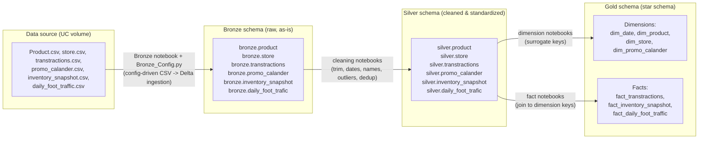

# Retail Data Lakehouse using Databricks

This project builds a retail data lakehouse on Databricks following the **medallion architecture**.

Raw retail data - transactions, products, stores, promotions, inventory snapshots, and daily foot traffic (CSV files in `data_source/`) - is ingested into the **Bronze** layer, then cleaned, validated, and standardized in the **Silver** layer. The **Gold** layer models the data into a star schema with dimension tables (date, product, store, promo) and fact tables (transactions, inventory snapshots, daily foot traffic), ready for analytics and BI. A dedicated test notebook runs quality checks on the Silver layer to ensure data reliability.

## Project structure

- `data_source/` - raw CSV source data
- `Scripts/bronze/` - Bronze layer ingestion (`bronze` notebook + `Bronze_Config.py`)
- `Scripts/silver/` - Silver layer cleaning and validation (one notebook per source)
- `Scripts/gold/` - Gold layer star schema (dimensions and facts)
- `test/` - data quality checks for the Silver layer

## What happens in each layer

### Bronze - Ingestion
The `bronze` notebook reads each raw CSV from `data_source/` (header + inferred schema, driven by the `Bronze_Config.py` ingestion config) and writes it as a Delta table into the `bronze` schema. Data is landed as-is, with no transformations applied.

### Silver - Cleaning & Standardization
Each source gets its own notebook that reads from Bronze and applies:
- **Trimming** leading/trailing whitespace from all string columns
- **Date normalization** - multiple date formats (`yyyy-MM-dd`, `dd/MM/yyyy`, ...) parsed into one standard date column
- **Text standardization** - title-casing store names and mapping inconsistent values (e.g. `Dwntwn Flagship` -> `Downtown Flagship`, `Lakeview Ctr` -> `Lakeview Center`) so each ID maps to exactly one name
- **Outlier handling** - unit prices more than 3x (or less than 1/3 of) the product's median price replaced with the median
- **Value mapping** - loyalty flags (`0/1` -> `no/yes`) and other coded values made human-readable
- **Column renaming** - to business-friendly names (e.g. `discount_pct` -> `applied_discount`, `unit_price` -> `applied_unit_price`)
- **Deduplication** - exact duplicate rows removed with a row-number window

Cleaned data is written as Delta tables into the `silver` schema (overwrite mode with schema evolution).

### Gold - Star Schema Modeling
Dimension tables are built from Silver - `dim_date`, `dim_product`, `dim_store`, and `dim_promo_calander` - each with surrogate keys. Fact tables (`fact_transtractions`, `fact_inventory_snapshot`, `fact_daily_foot_traffic`) are built by joining the Silver facts to the dimension surrogate keys (e.g. transactions join to the promo dimension on date range, store, and category). The result is an analytics-ready star schema in the `gold` schema for BI and reporting.

### Testing - Data Quality Checks
The `test/` notebook contains quality checks for the Silver layer and Gold layer to validate the cleaned data before it flows to Gold.

## Data pipeline structure

Raw CSVs live in the UC volume `workspace.bronze.store_sources` (`/Volumes/workspace/bronze/store_sources`) and flow through the layers as Delta tables in the `workspace` catalog:

In short:
1. **Ingest** - the Bronze notebook loops over `INGESTION_CONFIG` in `Bronze_Config.py`, reading each CSV and saving it as a Delta table in the `bronze` schema.
2. **Clean** - one notebook per table transforms the Bronze data and writes it to the `silver` schema.
3. **Model** - dimension notebooks build `dim_*` tables with surrogate keys, then fact notebooks join the Silver facts to those keys to build `fact_*` tables in the `gold` schema.
4. **Validate** - the test notebook runs quality checks on the Silver and Gold layers.

Each layer reads only from the layer above it, so any layer can be rebuilt by re-running its notebooks.